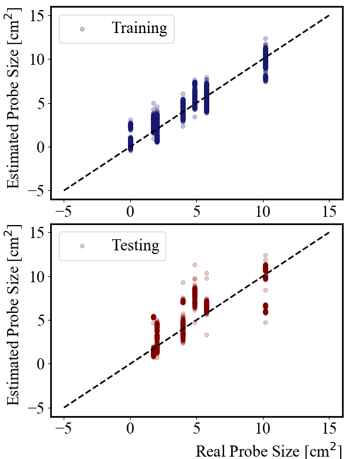
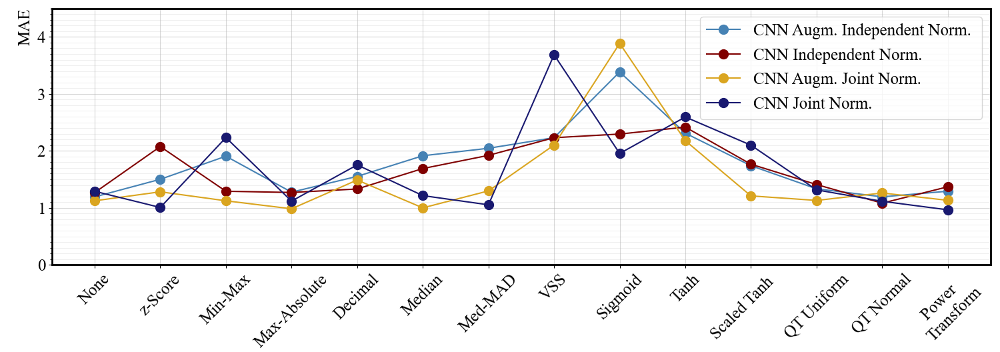

# Towards Processing Blood Volume Changes in Electrical Impedance Tomography Data
Feasibilty and Normalization of Electrical Impedance Tomography (EIT) Data featuring Blood Volume Changes characterized by a water tank measurement.

This repository contains algorithms, training routines and results for an analysis of preproccessing EIT data featuring emulated stroke volume changes from a water tank experiment. 


----------------------------------------------------------------------------------------------------------------------------------------
----------------------------------------------------------------------------------------------------------------------------------------
__Abstract:__   
Stroke volume is an essential hemodynamic parameter for monitoring and therapeutic decision-making in clinical practice. Because the gold standard measurement technique is invasive 
and existing non-invasive alternatives are either unsuitable for long-term use or lack accuracy, there is a clear need for new monitoring approaches. With electrical impedance tomography(EIT),
a non-invasive monitoring technique of the internal conductivity distribution, the estimation of hemodynamic parameters is possible but challenging. In this study, EIT data obtained from a water
tank experiment with multiple probes emulating different aortic blood volume levels, are used to investigate the most effective normalization strategy for EIT measurements. For each normalization approach,
a convolutional neural network is trained to estimate the probe area, with hyperparameter tuning performed to optimize network performance. The results indicate that blood volume estimation 
is most effective when using normalization on a joint feature space. Techniques like power transformation and max-absolute-scaling are suitable for tracking trends, although precise 
volume estimation remains challenging with the present dataset.
 
REFERENCES
 

----------------------------------------------------------------------------------------------------------------------------------------
----------------------------------------------------------------------------------------------------------------------------------------


## Overview:
- [Structure](#structure)
- [Installation](#installation)
- [Evaluation Results](#evaluation)
- [Author](#author)


## Structure
This repository includes:


## Installation
Clone the repository:
```bash
 git clone https://github.com/EITLabworks/Qualitative-Effects-Blood-Volume-EIT.git
```


## Evaluation Results
### Training and Testing Data Estimation Results


### MAE of different Normalization Strategies



## Author
This repository is created by Patricia Fuchs, Institute of Communications Engineering, University of Rostock, Germany.   
The research is based on the paper "Towards Processing Blood Volume Changes in Electrical Impedance Tomography Data " for the "Annual International Conference of the IEEE Engineering in Medicine and Biology Society" (EMBC) 2026.    
For questions, please contact: pat.fuchs@uni-rostock.de
