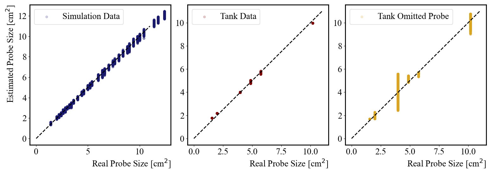
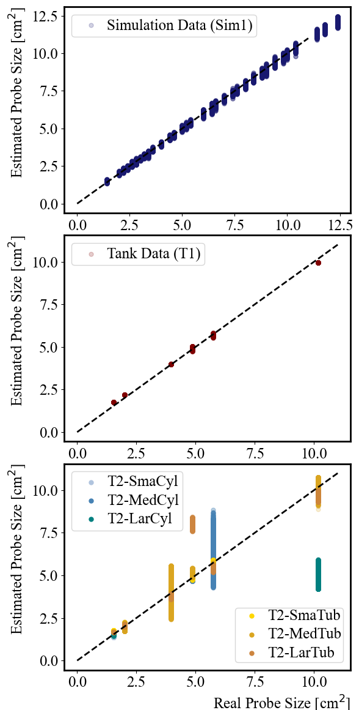
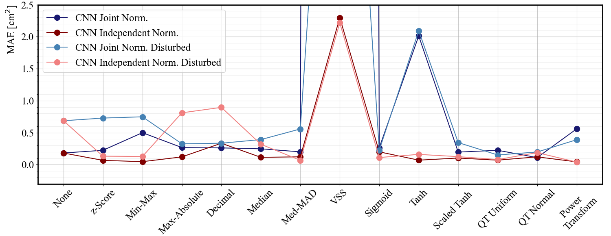
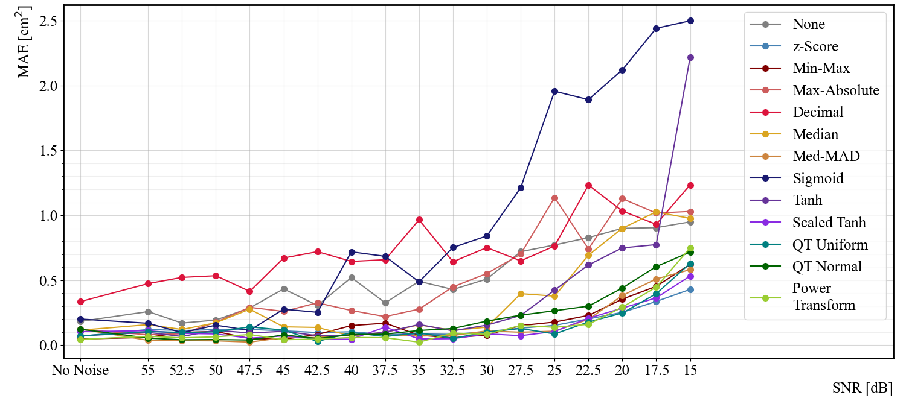
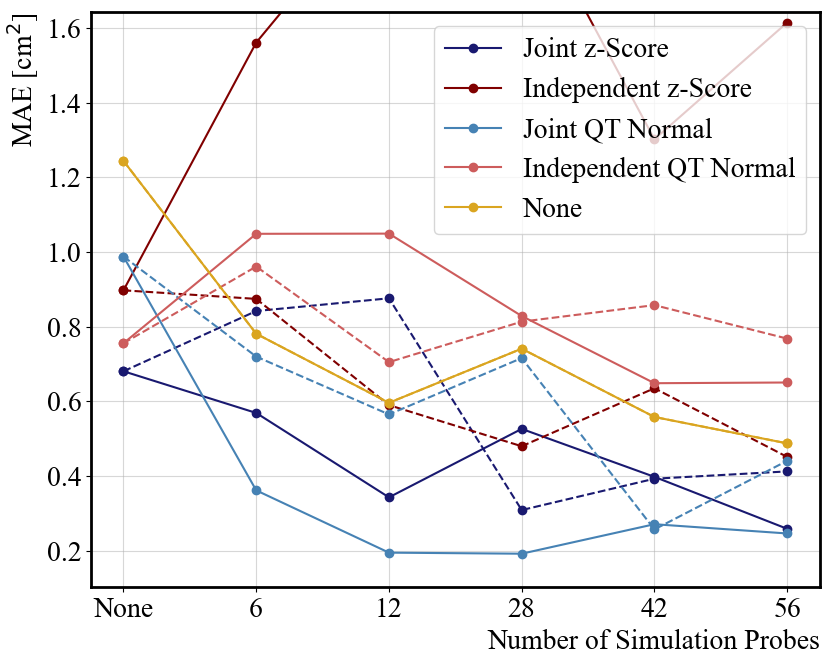

# Towards Processing Blood Volume Changes in Electrical Impedance Tomography Data
Feasibilty and Normalization of Electrical Impedance Tomography (EIT) Data featuring Blood Volume Changes characterized by a water tank measurement.
Analysis on the noise robustness and co-training with simulated data.


This repository contains algorithms, training routines and results for an analysis of preproccessing EIT data featuring emulated stroke volume changes from a water tank experiment. 


----------------------------------------------------------------------------------------------------------------------------------------
----------------------------------------------------------------------------------------------------------------------------------------
__Abstract:__   
Stroke volume is an essential hemodynamic parameter for monitoring and therapeutic decision-making in clinical practice.
Because the gold standard measurement technique is invasive and existing non-invasive alternatives are either 
unsuitable for long-term use or lack accuracy, there is a clear need for new monitoring approaches. With electrical 
impedance tomography (EIT), a non-invasive monitoring technique of the internal conductivity distribution, the 
estimation of hemodynamic parameters is possible but challenging. In this study, EIT data, obtained from a water 
tank experiment with multiple probes emulating different aortic blood volume levels, are used to investigate the 
capabilities of estimating blood volume from EIT and the most effective normalization strategy for EIT measurements. 
For each normalization approach, a convolutional neural network is trained to estimate the probe area, with 
hyperparameter tuning performed to optimize network performance. The best normalization axis and robustness against 
noise are also evaluated. The results indicate that blood volume estimation is most effective when using normalization 
on an independent feature space, with quantile transformations and z-score showing great noise tolerance for minimal 
errors. Together with a simulated dataset, it is shown that co-training simulation and measured data is helpful, 
especially when substantially more variability is introduced.
 
REFERENCES


----------------------------------------------------------------------------------------------------------------------------------------
----------------------------------------------------------------------------------------------------------------------------------------


## Overview:
- [Structure](#structure)
- [Installation](#installation)
- [Evaluation Results](#evaluation)
- [Author](#author)


## Structure
This repository includes:


## Installation
Clone the repository:
```bash
 git clone https://github.com/EITLabworks/Qualitative-Effects-of-Blood-Volume-in-EIT.git
```


## Evaluation Results
### Testing Data Estimation Results for Sim1, T1 and T2-MedTub


### Testing Data Estimation Results for Sim1, T1 and T2-X



### MAE of different Normalization Strategies


### Robustness to Noise of different Normalization Strategies


### Probe Variability for Co-Training Simulated and Recorded Data



## Author
This repository is created by Patricia Fuchs, Institute of Communications Engineering, University of Rostock, Germany.   
The research is based on the paper "Towards Processing Blood Volume Changes in Electrical Impedance Tomography Data " for the "20th International Joint Conference on Biomedical Engineering Systems and Technologies" (BioStec) 2027/ BioSignals.    
For questions, please contact: pat.fuchs@uni-rostock.de
